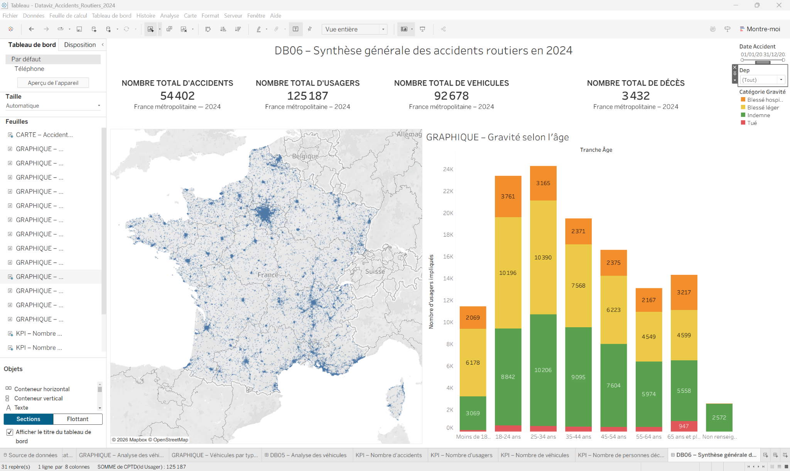

# Accidents routiers en France — 2024

**Livrable final du TP Data Visualisation Open Data — version du 16 novembre 2026**  
**Architecture :** données ouvertes → préparation SQL dans Navicat Premium Lite → MySQL → connexion directe → Tableau Desktop → six tableaux de bord → soutenance.

## Contenu du livrable

| Dossier | Contenu |
|---|---|
| `sql/base_complete/` | Export MySQL complet nettoyé (données, 4 tables et 5 vues) et schéma sans données |
| `sql/controle/` | Requêtes de vérification après import |
| `sql/historique_navicat/` | 13 scripts de travail originaux ; ne pas exécuter en bloc |
| `tableau/` | Classeur `.twbx` (18 feuilles, 6 dashboards) et procédure de reconnexion |
| `captures/` | Captures DB01 à DB06 et deux contrôles techniques |
| `documentation/` | Rapport technique final `.docx` et version PDF |
| `presentation/` | Présentation PowerPoint pour 10 à 15 minutes |
| `data/` | Métadonnées et provenance des données à compléter |

## Indicateurs de référence (DB06 sans filtre départemental)

| KPI | Valeur affichée |
|---|---:|
| Accidents | **54 402** |
| Usagers impliqués | **125 187** |
| Véhicules impliqués | **92 678** |
| Personnes décédées | **3 432** |

Ces valeurs sont observées sur les captures Tableau. Le nombre de décès n'a pas été recalculé indépendamment dans l'environnement d'assemblage.

## Reconstruction de la base MySQL

1. Installer **MySQL 8.0** et un client SQL (Navicat Premium Lite convient).
2. Utiliser **une base de test vide** : `sql/base_complete/dataviz_accidents_2024_propre.sql` comporte des `DROP TABLE` et `DROP VIEW` ; il détruit les objets existants portant ces noms.
3. Exécuter ce fichier en UTF-8. Il crée et sélectionne la base `dataviz_accidents_2024`.
4. Exécuter `sql/controle/verification_import_2024.sql` et vérifier les volumes : 54 403 caractéristiques (dont `Num_Acc = 0`), 70 249 lieux, 125 187 usagers et 92 678 véhicules. La vue des accidents exclut `Num_Acc = 0` et doit compter 54 402 accidents.
5. Vérifier la présence des vues `vue_accidents_2024`, `vue_cartographie_2024`, `vue_luminosite_2024`, `vue_usagers_2024`, `vue_vehicules_2024`.

Le fichier `schema_et_vues_2024.sql` sert à consulter la structure sans données : il ne remplace **pas** l'export complet pour reproduire les graphiques.

## Ouverture du projet Tableau Desktop

1. Ouvrir `tableau/Dataviz_Accidents_Routiers_2024.twbx`.
2. Configurer l'accès à MySQL local (port 3306 ou port effectif) ; installer le pilote MySQL compatible si Tableau le demande.
3. Actualiser les données et contrôler les quatre KPI et les six dashboards.
4. Tester les filtres et actions sur DB01 et DB06. Voir `tableau/VERIFICATION_CONNEXION.md`.

**Attention :** le `.twbx` contient une connexion MySQL **en direct**, et **aucun extrait de données**. Il ne fonctionnera pas hors connexion à MySQL sans modification.

## Tableaux de bord

- [DB01 — Cartographie](captures/DB01_cartographie.png)
- [DB02 — Analyse temporelle](captures/DB02_analyse_temporelle.png)
- [DB03 — Conditions](captures/DB03_conditions.png)
- [DB04 — Usagers](captures/DB04_usagers.png)
- [DB05 — Véhicules](captures/DB05_vehicules.png)
- [DB06 — Synthèse générale](captures/DB06_synthese_generale.png)

## Démarche et limites

La préparation et les contrôles ont été réalisés dans **Navicat Premium Lite**, avec MySQL comme moteur de stockage et de requêtes. Une anomalie de comparaison des longitudes texte a été corrigée dans la vue cartographique (normalisation des virgules décimales et conversion explicite). Les nombres représentent des volumes enregistrés et **non** des taux de risque : l'exposition au trafic n'est pas disponible. Les données 2024 seules ne permettent pas d'établir une tendance pluriannuelle.

## Statut de validation et informations manquantes

- **Vérifié statiquement :** présence des fichiers, structure SQL, quatre tables et cinq vues, structure du classeur Tableau (18 feuilles / 6 dashboards), captures et support.
- **Non testé ici :** restauration MySQL, exécution des vues sur une base réimportée, rafraîchissement du classeur sur un autre poste.
- **À renseigner :** URL officielle du jeu de données, producteur, licence, date/méthode de téléchargement, pilote de connexion utilisé et éventuelle validation de Navicat par le formateur.
- **À faire avant dépôt public :** contrôle des métadonnées, des droits de réutilisation et de l'absence de secrets. Aucun mot de passe ne doit être publié.

Voir [`CHECKLIST_AVANT_REMISE.md`](CHECKLIST_AVANT_REMISE.md) et [`data/README.md`](data/README.md).
