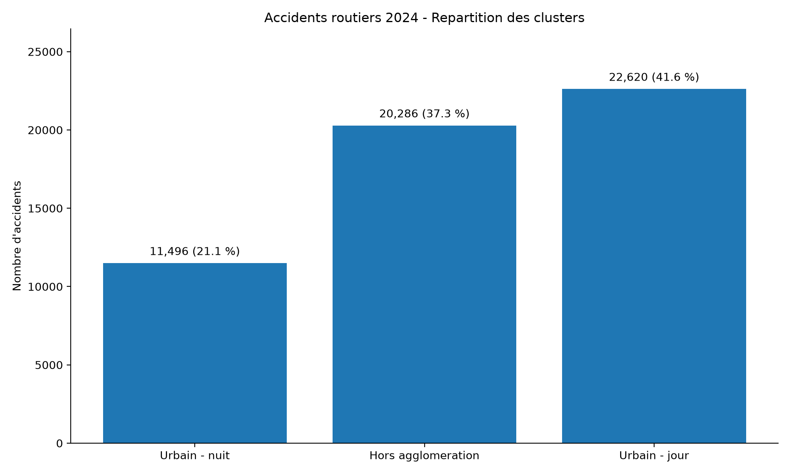
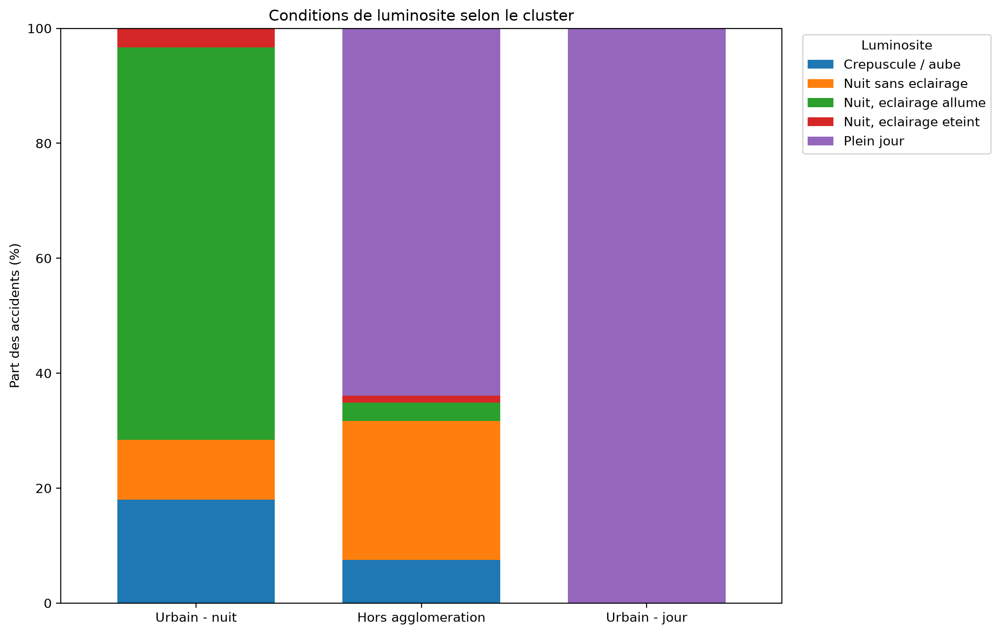

# Accidents routiers en France — 2024

**Livrable du TP Data Visualisation Open Data — mise à jour documentaire du 16 novembre 2026**

**Chaîne de traitement :** données ouvertes BAAC 2024 → import et préparation SQL avec Navicat Premium Lite / MySQL → vues SQL → connexion MySQL directe → Tableau Desktop → six tableaux de bord → clustering K-means sous Python → soutenance.

## Source des données

- **Producteur :** Ministère de l'Intérieur ; données BAAC diffusées par l'Observatoire national interministériel de la sécurité routière (ONISR).
- **Plateforme :** [data.gouv.fr — Bases de données annuelles des accidents corporels](https://www.data.gouv.fr/datasets/bases-de-donnees-annuelles-des-accidents-corporels-de-la-circulation-routiere-annees-de-2005-a-2025).
- **Périmètre :** France, accidents corporels enregistrés en 2024.
- **Fichiers utilisés :** `caract-2024.csv`, `lieux-2024.csv`, `vehicules-2024.csv`, `usagers-2024.csv`.
- **Licence indiquée dans la documentation du projet :** Licence Ouverte / Open Licence.
- **Date exacte du téléchargement initial :** à confirmer (ne pas confondre avec la date des contrôles du 16 novembre 2026).

Voir [data/README.md](data/README.md) pour les sources, les volumes, les contrôles et les informations restant à renseigner.

## Contenu du dépôt

| Dossier / fichier | Contenu |
|---|---|
| `sql/base_complete/` | Export MySQL avec données (4 tables métier et 5 vues) et schéma sans données |
| `sql/controle/` | Requêtes de vérification, résultats des contrôles d'intégrité et de restauration |
| `sql/historique_navicat/` | 13 scripts de travail historiques ; certains modifient les données : ne pas exécuter en bloc |
| `machine_learning/` | Clustering K-means des 54 402 accidents : scripts Python, données préparées, profils et graphiques |
| `tableau/` | Classeur `.twbx` (18 feuilles, 6 dashboards) et procédure de reconnexion |
| `captures/` | Six captures de dashboards et quatre captures techniques |
| `documentation/` | Rapport technique Word et PDF |
| `presentation/` | Soutenance PowerPoint et PDF (10 à 15 minutes) |
| `data/` | Provenance des données, métadonnées et contrôles |
| `MANIFEST_SHA256.tsv` | Manifeste historique : **à régénérer après les dernières modifications**, voir la checklist |

## Indicateurs de référence (DB06, sans filtre départemental)

| Indicateur | Valeur affichée |
|---|---:|
| Accidents | **54 402** |
| Usagers impliqués | **125 187** |
| Véhicules impliqués | **92 678** |
| Personnes décédées | **3 432** |

Ces valeurs proviennent des résultats et captures du projet. Le total de décès n'a pas été recalculé indépendamment lors de l'assemblage du livrable.

## Reconstruction de la base MySQL

1. Installer MySQL 8.0 et un client SQL compatible (Navicat Premium Lite a été utilisé pour le projet).
2. Utiliser une **instance / base de test**, sans données à conserver. Le fichier `sql/base_complete/dataviz_accidents_2024_propre.sql` comporte des instructions `DROP TABLE` et `DROP VIEW`.
3. Exécuter cet export en UTF-8. Il recrée la base `dataviz_accidents_2024` ; vérifier les instructions avant toute exécution.
4. Exécuter `sql/controle/verification_import_2024.sql` et vérifier : 54 403 lignes dans `caracteristiques` (dont une ligne `Num_Acc = 0`), 70 249 dans `lieux`, 125 187 dans `usagers-2024` et 92 678 dans `vehicules-2024`.
5. Vérifier les cinq vues : `vue_accidents_2024`, `vue_cartographie_2024`, `vue_luminosite_2024`, `vue_usagers_2024`, `vue_vehicules_2024`. La vue des accidents doit compter **54 402** lignes.

`schema_et_vues_2024.sql` décrit la structure sans les données ; il ne remplace pas l'export complet.

### Contrôles de restauration et d'intégrité

Le **16 novembre 2026**, une restauration a été réalisée dans une base de test indépendante `dataviz_accidents_2024_test`. Selon les résultats enregistrés dans le projet :

- **342 545 requêtes SQL** exécutées sans erreur ;
- **4 tables métier** restaurées avec les volumes attendus ;
- **5 vues** recréées et interrogées ;
- **4 contrôles de relations** par jointures externes : **0 référence orpheline** détectée sur les relations contrôlées, pour les clés non nulles.

Les fichiers `sql/controle/verification technique.csv`, `sql/controle/verification_restauration.txt` et les captures `03_controle_tables.png`, `04_verification_integrite_restauration.png` documentent ces résultats. Ces contrôles ne démontrent pas à eux seuls l'absence de toute anomalie de qualité.

## Ouverture du classeur Tableau Desktop

1. Ouvrir `tableau/Dataviz_Accidents_Routiers_2024.twbx`.
2. Configurer la connexion à MySQL local (port 3306 ou port réellement utilisé) et installer le pilote compatible si nécessaire.
3. Actualiser les données, comparer les KPI et contrôler les six dashboards.
4. Tester les filtres et actions de DB01 et DB06 ; consulter [tableau/VERIFICATION_CONNEXION.md](tableau/VERIFICATION_CONNEXION.md).

**Important :** le `.twbx` utilise une **connexion directe MySQL** et ne contient **aucun extrait de données**. Le fonctionnement sur un autre poste, après restauration, reste à valider dans Tableau Desktop.

## Six tableaux de bord

- [DB01 — Cartographie](captures/DB01_cartographie.png)
- [DB02 — Analyse temporelle](captures/DB02_analyse_temporelle.png)
- [DB03 — Conditions](captures/DB03_conditions.png)
- [DB04 — Usagers](captures/DB04_usagers.png)
- [DB05 — Véhicules](captures/DB05_vehicules.png)
- [DB06 — Synthèse générale](captures/DB06_synthese_generale.png)

## Machine Learning — segmentation des accidents

Un module de **Machine Learning non supervisé** complète les six tableaux de bord Tableau Desktop. Il cherche à regrouper les accidents présentant des caractéristiques similaires, **sans prédire** la survenue d'un accident ni sa gravité.

- **Données :** 54 402 accidents corporels enregistrés en France en 2024, issus de la vue SQL `vue_accidents_2024`.
- **Variables étudiées :** heure, luminosité, conditions atmosphériques, type d'intersection, localisation en ou hors agglomération et type de collision. L'identifiant de l'accident est exclu de l'apprentissage.
- **Préparation :** transformation cyclique de l'heure, encodage One-Hot des catégories, puis pondération des groupes de variables ; 35 variables numériques obtenues.
- **Algorithme :** K-means avec scikit-learn, comparaison de `k=2` à `k=6` sur un échantillon de 10 000 accidents (score de silhouette évalué sur 2 000 observations), puis entraînement final sur l'ensemble des 54 402 accidents.
- **Résultat :** `k=3` est le meilleur nombre de clusters parmi les valeurs testées, avec un **score de silhouette de 0,1769**.

| Cluster | Profil descriptif | Accidents | Part |
|---|---|---:|---:|
| 0 | Urbain, principalement nocturne | 11 496 | 21,1 % |
| 1 | Hors agglomération, majoritairement diurne | 20 286 | 37,3 % |
| 2 | Urbain, de jour | 22 620 | 41,6 % |
| **Total** | | **54 402** | **100 %** |

Les profils sont des **descriptions établies après le regroupement**. Le score de silhouette relativement faible indique une séparation limitée entre les groupes : cette segmentation est **exploratoire** et ne constitue ni une classification de risques routiers ni une preuve de catégories naturelles nettement distinctes.

**Résultats visuels :**

Les scripts Python, les fichiers CSV, les résultats détaillés, les instructions de reproduction et les limites méthodologiques sont documentés dans le **[README du module Machine Learning](machine_learning/README.md)**.

## Méthode et limites

La préparation et les contrôles ont été réalisés dans Navicat Premium Lite, MySQL servant au stockage et aux requêtes. Une anomalie de comparaison des longitudes textuelles a été corrigée dans la vue cartographique par normalisation des virgules décimales et conversion explicite. Les volumes décrivent les accidents enregistrés, **pas un risque rapporté au trafic**. L'analyse de 2024 ne permet pas d'établir une tendance pluriannuelle.

## Vérifications restant à terminer avant publication

- Compléter la **date initiale de collecte**, les dimensions et les formats exacts des CSV, ainsi que les paramètres d'import.
- Documenter la **version du pilote MySQL** utilisé et vérifier, si nécessaire, l'acceptation de Navicat Premium Lite par le formateur.
- Tester le **rafraîchissement Tableau et les interactions après restauration**, sur l'environnement prévu pour la soutenance.
- Contrôler les **secrets, les métadonnées, les droits de réutilisation et l'historique Git** avant de rendre le dépôt public.
- Manifeste SHA256 généré et contrôlé le 16 novembre 2026 : 42 fichiers vérifiés, empreintes et tailles conformes.
- Vérifier la visibilité **Public** et l'accès anonyme au dépôt, puis répéter la soutenance.

Voir [CHECKLIST_AVANT_REMISE.md](CHECKLIST_AVANT_REMISE.md). **Ne jamais publier de mot de passe.**
